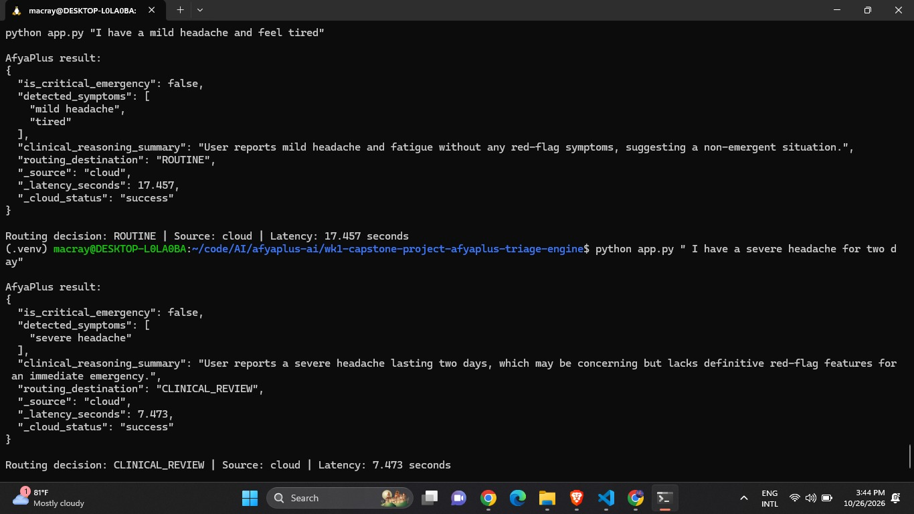
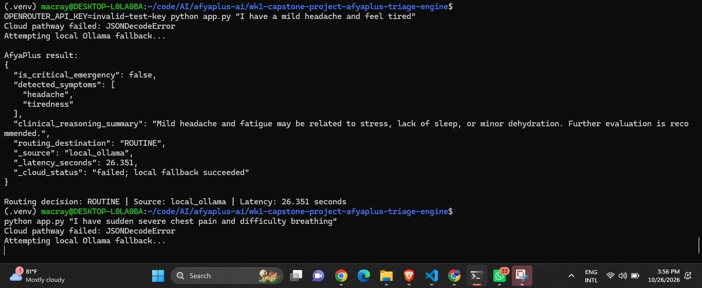
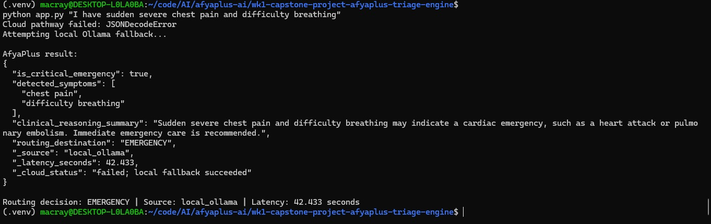

# AfyaPlus Triage Engine — Sample Outputs

This document records three example runs of the AfyaPlus triage engine.
The outputs demonstrate cloud inference, local Ollama fallback, and
emergency routing.

These examples are for software demonstration only, not medical advice.

## Sample 1: Cloud Inference Success

**Input**

```text
I have a mild headache and feel tired
```

**Result**

```json
{
  "is_critical_emergency": false,
  "detected_symptoms": [
    "mild headache",
    "tired"
  ],
  "clinical_reasoning_summary": "User reports mild headache and fatigue without any red-flag symptoms, suggesting a non-emergent situation.",
  "routing_destination": "ROUTINE",
  "_source": "cloud",
  "_latency_seconds": 17.457,
  "_cloud_status": "success"
}
```
### Screenshot



**Observation:** The cloud model returned a structured result that passed
the application's validation.

## Sample 2: Cloud Failure and Local Fallback

**Input**

```text
I have a mild headache and feel tired
```

**Observed log**

```text
Cloud pathway failed: JSONDecodeError
Attempting local Ollama fallback...
```

**Result**

```json
{
  "is_critical_emergency": false,
  "detected_symptoms": [
    "headache",
    "tiredness"
  ],
  "clinical_reasoning_summary": "Mild headache and fatigue may be related to stress, lack of sleep, or minor dehydration. Further evaluation is recommended.",
  "routing_destination": "ROUTINE",
  "_source": "local_ollama",
  "_latency_seconds": 26.351,
  "_cloud_status": "failed; local fallback succeeded"
}
```
### Screenshot



**Observation:** The cloud pathway failed, but the local Ollama model
returned a result. This demonstrates the fallback pathway.

## Sample 3: Emergency Routing with Local Fallback

**Input**

```text
I have sudden severe chest pain and difficulty breathing
```

**Observed log**

```text
Cloud pathway failed: JSONDecodeError
Attempting local Ollama fallback...
```

**Result**

```json
{
  "is_critical_emergency": true,
  "detected_symptoms": [
    "chest pain",
    "difficulty breathing"
  ],
  "clinical_reasoning_summary": "Sudden severe chest pain and difficulty breathing may indicate a cardiac emergency, such as a heart attack or pulmonary embolism. Immediate emergency care is recommended.",
  "routing_destination": "EMERGENCY",
  "_source": "local_ollama",
  "_latency_seconds": 42.433,
  "_cloud_status": "failed; local fallback succeeded"
}
```

### Screenshot



**Observation:** The application classified the reported red-flag symptoms
for emergency routing after falling back to the local model.

## Performance Summary

| Sample | Inference source | Outcome | Latency |
|---|---|---|---:|
| 1 | Cloud | Success | 17.457 s |
| 2 | Local Ollama | Fallback succeeded | 26.351 s |
| 3 | Local Ollama | Emergency fallback succeeded | 42.433 s |

## Limitations

- These are example runs, not a comprehensive clinical validation.
- Latency varies by model, network, and local hardware.
- The configured cloud timeout is 4 seconds, but the observed cloud
  latency measurements exceeded that value. Timeout behavior needs
  further verification.
- The application supports triage routing demonstrations; it does not
  diagnose conditions or replace qualified medical professionals.
